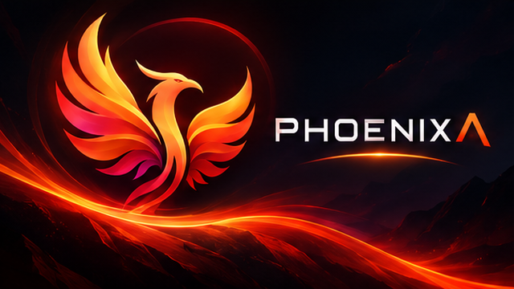

<div align="center">


# PHOENIXA

**A cinematic Jellyfin client for Fire TV, Android TV and Android phones.**

Built for the couch: big artwork, calm navigation, and a player that plays your files exactly as they are.

[](https://github.com/hansonds/PHOENIXA/actions/workflows/build.yml)
[](https://github.com/hansonds/PHOENIXA/releases/latest)




### Download

<a href="https://play.google.com/store/apps/details?id=org.phoenicx.nova"></a>

<a href="https://github.com/hansonds/PHOENIXA/releases/latest/download/PHOENIXA.apk"></a>

**Google Play** for Android TV, Google TV and phones · **APK** for Fire TV, Android boxes and phones (Downloader code **`4563854`**)

</div>

---

## ✦ Why PHOENIXA?

The official Jellyfin TV app works, but it looks dated and can be awkward with a remote. PHOENIXA is a native TV app with its own elegant dark theme. It isn't a web page in a wrapper. Every screen is designed around the D-pad, so you always know where the highlight is and how to get back.

## ✨ Features

### Home
- **Featured carousel**: full-screen backdrops with title logos, rating, year, runtime and quality badges. It auto-rotates, and you can flip slides with left and right.
- **Continue Watching**, **Next Up**, **Recently Added** for each library, and **My Favorites** rows.
- On phones, a slim top strip with the **PHOENIXA** logo, the **time** and a small **battery** indicator (green, orange below 15%, red below 10%).
- A simple top bar on TV (**Home · Library · Search · Add · Profile**) that always stays the same, plus a small clock. **Library** shows every library and Favorites on one page.
- On phones, a **bottom bar** (Home · Library · Search · Add · Profile) within reach of your thumb. **Library** shows every library and Favorites on one page.
- Grey **placeholder cards** while pages load, and **pull down to refresh** on phones and tablets.
- **Android TV / Google TV:** what you're watching appears in the TV home screen's **Continue watching** row. Pick it there and it plays straight away.

### Notifications & messages
- **Instant "New on PHOENIXA" notifications** on phones and tablets the moment a movie, series or episode is added to your server, with its poster. Tap one to open the title. They arrive as real push notifications (like WhatsApp), so nothing runs in the background on your phone.
- Each person only hears about titles in the libraries they're allowed to see. Several new episodes of one show come together as one notification ("Lupin · 3 new episodes").
- **Messages from the server owner** (for example "Server maintenance tonight"):
  - **Phones:** a notification you can expand to read in full, in its own "Messages from the server" category.
  - **TV and Fire TV:** a banner at the top of the screen, **even while a movie is playing**. Playback keeps going and the banner hides by itself.
- PHOENIXA asks for notification permission right after you sign in. **Settings → Notifications** shows whether everything works and has a **Send a test notification** button.
- Needs the **[Torvia](https://github.com/hansonds/Torvia-Jellyfin)** plugin on your server with its free Firebase setup (Torvia → Push notifications).

### Browsing
- **Library grids** sorted by Recently Added, A–Z, Top Rated, Release Year or Random. The app remembers where you were when you come back.
- **Collections** (box sets) show every movie and series inside them.
- **Favorites** page with All / Movies / Shows / Episodes filters.
- **Search** across movies, shows and episodes.

### Detail pages
- Logo, metadata, genres, tagline, overview, an "Ends at" time and remaining time.
- Picker for **Version / Audio / Subtitles** before you press Play, for files with several versions or tracks.
- Quality badges: **4K, HDR10, HDR10+, Dolby Vision, HLG, Atmos, TrueHD, DTS, 5.1 / 7.1**.
- Series: season tabs and episode cards. Play resumes the next episode automatically.
- **Cast & Crew** cards open an **actor page** with photo, birth details, biography (with *Read more*) and everything they appear in on your server.
- Mark as watched, add to favorites, and **More Like This**.

### Player
- **ExoPlayer (Media3)**, the same engine Google and the official Jellyfin TV app use.
- **Direct play first.** Video is decoded by your TV's own hardware chip, including HEVC, AV1 where supported, and HDR.
- **FFmpeg audio decoder** built in, so **DTS, DTS-HD, TrueHD, E-AC3** and other formats play even when the TV can't decode them. Passthrough to a soundbar or receiver is used when available.
- Optional automatic transcode fallback, if you enable it on your server.
- Subtitle and audio track picker with **real language names** (Tamil, Hindi, Malayalam, English …). Your language choice is **remembered**, and **per series**: pick Malayalam audio with English subtitles once, and every episode of that show starts the same way.
- Playback **speed** from 0.5× to 2×.
- Synopsis and cast overlay, a seek bar with hold-to-scrub, skip ±10 s, and **auto-play next episode**.
- Watch progress syncs to your server, so you can continue on any device.
- **Phones and tablets:** swipe up or down for volume (right side) and brightness (left side), swipe left or right to seek, double-tap a side to skip 10 s (keep tapping to add more), press and hold for **2× speed**, pinch to zoom, and a **🔒 lock** button against pocket touches.
- **Remote:** the ⏯ ⏪ ⏩ media keys always work, and holding **OK** (or pressing **Menu**) opens quick options: subtitles, audio, speed, screen size, next episode.

### Add (Torvia servers)
- If your Jellyfin server runs the **[Torvia](https://github.com/hansonds/Torvia-Jellyfin)** plugin, an **Add** button appears next to Search for allowed users (TV, phone and tablet).
- Search by name or a TMDB / IMDb link. Series open on the whole season; pick an episode only if you want one. Filter releases the same way as Torvia's web page (quality, type, video, language, sort) and add one to TorBox. PHOENIXA waits for it to appear in Jellyfin and opens it.
- **Add a link** (phones and tablets): paste your own magnet link or pick a torrent file, choose the title, and follow its download progress.
- **My adds** lists what you added, with Open and Remove. Admins can see everyone's. Daily limits and permissions come from the server.
- Servers without the plugin don't show the tab at all.

### Comfort
- **Quick Connect** sign-in, so there's no typing on the remote.
- **Profiles:** sign in several people on one device. PHOENIXA asks "Who's watching?" when it starts (with one profile it opens straight to Home). Switch any time from your picture in the top bar or from Settings.
- The keyboard opens only when you press OK on a text box.
- **11 colour themes** (Phoenix Ember, Nova, Midnight Blue, Emerald, Royal Purple, Crimson Noir, Ocean Teal, Sunset Gold, Rose Quartz, Graphite, Cyber Neon), changed instantly from Settings.
- Card size setting (Small, Medium or Large) and a streaming quality limit.
- A **glass highlight** on TV that glides from tile to tile, tinted with your theme colour.
- Calm, snappy scrolling tuned for Fire TV Sticks: the screen stays still while the highlight moves, and right at the end of a row continues on the next row.
- Your server's **Devices** page shows each device by its own name ("Hanson's S23") and the real PHOENIXA version.
- Small app size (about 13 MB) and a self-managing image cache.

---

## 📥 Install

### Google Play (Android TV, Google TV, phones and tablets)
<a href="https://play.google.com/store/apps/details?id=org.phoenicx.nova"></a>

Install from Google Play and updates come automatically.

### Fire TV / Fire TV Stick
1. On your Fire TV, go to **Settings → My Fire TV → Developer options** and allow **Apps from Unknown Sources** (or allow the *Downloader* app).
2. Install **Downloader** from the Amazon Appstore.
3. Open Downloader and enter the code **`4563854`**
   (or the full address: `https://github.com/hansonds/PHOENIXA/releases/latest/download/PHOENIXA.apk`)
4. Install, open **PHOENIXA**, and sign in.

### Android TV / Google TV / Android boxes
Install **Downloader** from the Play Store and enter the same code **`4563854`**. You can also use **Send Files to TV**, or copy the APK over USB and open it with a file manager.

### Android phones and tablets
Get it from **[Google Play](https://play.google.com/store/apps/details?id=org.phoenicx.nova)**, or download the same **[PHOENIXA.apk](https://github.com/hansonds/PHOENIXA/releases/latest/download/PHOENIXA.apk)** on your phone from GitHub and open it to install (allow "Install unknown apps" for your browser when asked).

On a phone the app uses the same design in **portrait**, made for touch (videos open in landscape). On a **tablet** it rotates freely: the wide TV-style layout when held sideways, the portrait layout when held upright. Touch controls: tap anything to open it, swipe the home banner to change the featured title, tap the video to show or hide the controls, double-tap the left or right side to skip 10 s, and drag the seek bar to jump.

### Updating
Google Play updates PHOENIXA by itself. For the APK, download and install the new one in the same way: it installs over the old version and keeps your login and settings.

> The Google Play version and the GitHub APK are signed differently, so one can't be installed over the other. To switch, uninstall first (you'll need to sign in again).

---

## 🔑 Signing in

1. Enter your server address (for example `your-server.com` or `http://192.168.1.10:8096`).
2. Then either:
   - **Quick Connect** (recommended): PHOENIXA shows a 6-digit code. On your phone or computer, open Jellyfin → **Profile → Quick Connect**, enter the code, and the TV signs in by itself.
   - **Username and password**: press **OK** on a box to type.

> Quick Connect must be enabled on the server: **Dashboard → General → Quick Connect**.

---

## 🎮 Remote controls

| Where | Button | Action |
|---|---|---|
| Anywhere | **Back** | Go back one step |
| Home banner | **◀ ▶** on the edge buttons | Previous / next featured title |
| Home rows | **▲** on the first row | Jump to the banner, then the top bar |
| Player (controls hidden) | **OK** | Play / pause and show controls |
| Player (controls hidden) | **◀ ▶** | Rewind / forward 10 s |
| Player (controls hidden) | **▲ ▼** | Show controls |
| Player seek bar | **◀ ▶** (hold) | Scrub. Holding speeds up to 30 s steps |
| Player | **⏯ / ⏪ / ⏩** media keys | Play-pause / rewind / fast-forward (always work) |
| Player | **OK** (hold) or **Menu** | Quick options: subtitles, audio, speed, screen size, next episode |
| Text boxes | **OK** | Open the keyboard |

---

## ⚙️ Settings

| Setting | What it does |
|---|---|
| **Profile** | Switch to someone else, or add a person to this device. |
| **Direct play only** | *On (default):* always play the original file. *Off:* let the server transcode files the TV can't play (requires transcoding enabled on the server). |
| **Streaming quality** | Caps bitrate for slow connections (Maximum → 4 Mbps). |
| **Theme** | Pick one of 11 colour themes. *Phoenix Ember* is the default. |
| **Card size** | Small / Medium / Large posters and thumbnails, applied instantly. |
| **Auto-play next episode** | Starts the next episode when one ends. |
| **Rotate featured carousel** | Turns banner auto-rotation on or off. |
| **Notifications** (phones) | New movies & shows on or off, and **Send a test notification**. |
| **Rate on Google Play** | Shown only when PHOENIXA was installed from Google Play. |

---

## 🎬 Format support

| | Supported |
|---|---|
| **Containers** | MKV, MP4, M4V, MOV, WebM, TS, AVI |
| **Video** | H.264, HEVC/H.265 (incl. 10-bit), VP9, AV1\*, MPEG-2/4\* |
| **HDR** | HDR10, HDR10+, HLG, Dolby Vision\* |
| **Audio** | AAC, MP3, FLAC, Opus, Vorbis, ALAC, PCM, AC3, E-AC3, **DTS / DTS-HD**, **TrueHD** |
| **Subtitles** | SRT, ASS/SSA, WebVTT, PGS, DVD/DVB (embedded or external) |

\* Depends on what your TV's chip supports. PHOENIXA checks the device at startup and tells the server exactly what it can play.
Dolby Vision profile 7 (some Blu-ray rips) falls back to its HDR10 base layer on most devices.

---

## ❓ Troubleshooting

<details>
<summary><b>"Can't play this" error</b></summary>

Your TV's chip probably can't decode that video (common with AV1 or 4K HEVC on older or budget TVs). Either keep an H.264 or HEVC version of the file, or enable transcoding on the server and turn **Direct play only** off in PHOENIXA Settings. The error screen lists the exact reason, which helps when reporting an issue.
</details>

<details>
<summary><b>No notifications on my phone</b></summary>

Open **Settings → Notifications** in PHOENIXA: it tells you what's missing. Your server needs Torvia with push notifications set up, PHOENIXA must be allowed to send notifications, and the phone needs Google Play services. **Send a test notification** checks the whole chain.
</details>

<details>
<summary><b>Quick Connect says it's disabled</b></summary>

Enable it on the server: **Dashboard → General → Quick Connect**.
</details>

<details>
<summary><b>Actor has no photo or biography</b></summary>

That data comes from your server's metadata. Refresh the movie's metadata in Jellyfin (**⋮ → Refresh metadata**) to download missing people info.
</details>

<details>
<summary><b>Free up space</b></summary>

Posters are cached (up to 250 MB) and the oldest are removed automatically. You can also clear it in **Fire TV Settings → Applications → Manage Installed Applications → PHOENIXA → Clear cache**. This doesn't sign you out.
</details>

---

## Privacy and data deletion

PHOENIXA has no account system of its own and sends nothing to its developer. Your sign-in, watch history and settings go only to **your own Jellyfin server**, and stay on your device.

On phones, if the server has push notifications turned on (Torvia), PHOENIXA sends that server a **notification ID** (a Firebase Cloud Messaging token) plus the device's name and PHOENIXA version, so it can deliver notifications. Google's Firebase service delivers them.

**To delete this data**, do any of these in PHOENIXA:
- **Settings → Notifications → turn off** "New movies & shows": the notification ID is removed from the server straight away.
- **Settings → Sign out**, or remove your profile under **Who's watching? → Manage profiles**: the ID is removed and the device is signed out of the server.
- **Uninstall PHOENIXA**: the ID stops working, and the server deletes it the next time it tries to use it.

Your Jellyfin account itself (and its watch history) belongs to your server: ask the server's owner to delete it. For anything else, email **hanson.in@outlook.com**.

---

## 🛠 Build from source

Every push to `main` builds a signed release APK with GitHub Actions and publishes it to **Releases → latest**.

To build the Android app locally you need JDK 17 and the Android SDK (compileSdk 36):

```bash
gradle assembleRelease
# → app/build/outputs/apk/release/app-release.apk
```

**Tech stack:** Kotlin · Jetpack Compose · AndroidX Media3 (ExoPlayer) · Jellyfin FFmpeg audio decoder · Coil · OkHttp

> ⚠️ The signing key in `keystore/` exists so that sideloaded updates install over each other. If you fork this project for public distribution or store release, generate your own key and keep it private.

---

## 🤖 AI disclosure

PHOENIXA was built with help from AI. I'm not a professional developer: I designed the app, decided how it should look and behave, and tested every build on my own Fire TV and Android TV. The Kotlin code was largely written by an AI assistant (Claude by Anthropic), working from my instructions and bug reports.

The full source is here, so anyone can read or review it. Bug reports and pull requests are very welcome.

---

## 🙏 Credits

- Created by **[Hanson](https://github.com/hansonds)**.
- Powered by **[Jellyfin](https://jellyfin.org)**, the free software media system.
- Playback by **[AndroidX Media3 / ExoPlayer](https://github.com/androidx/media)** and the **[Jellyfin FFmpeg decoder](https://github.com/jellyfin/jellyfin-androidx-media)**.

PHOENIXA is an independent project and is not affiliated with or endorsed by the Jellyfin project or Amazon.

<div align="center">

**If you enjoy PHOENIXA, give the repo a ⭐**

</div>
