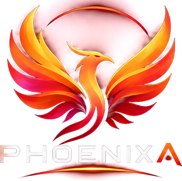
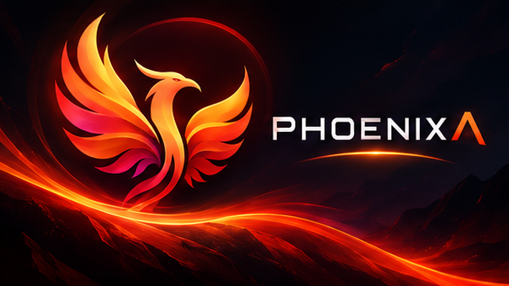
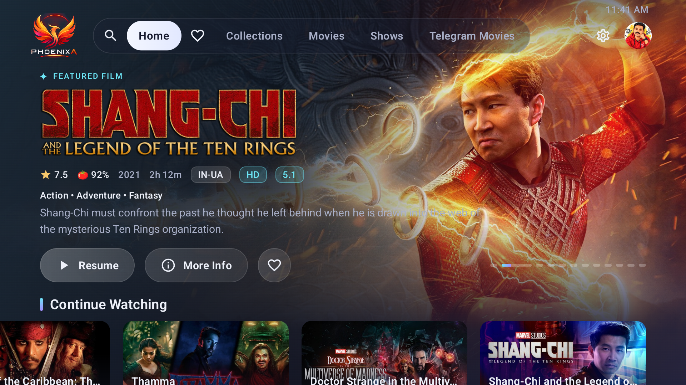
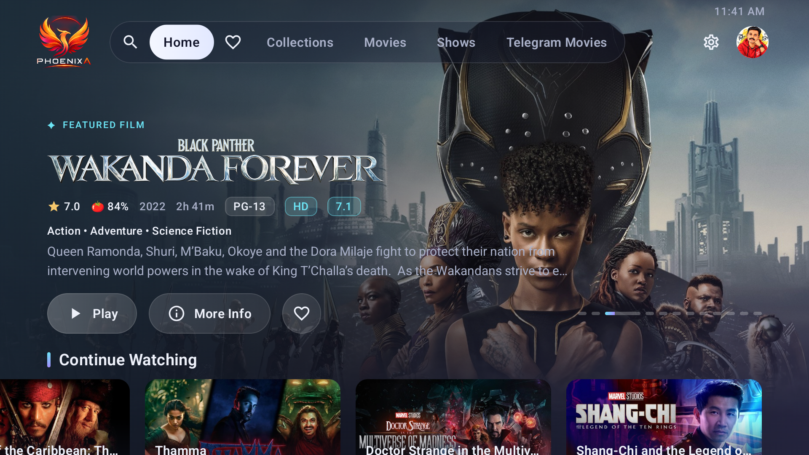
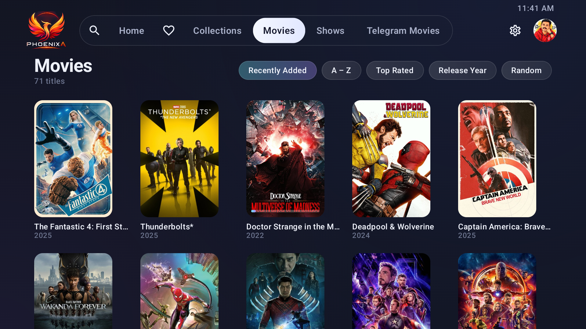

<div align="center">



# PHOENIXA

**A cinematic, remote-first Jellyfin client for Fire TV and Android TV.**

Built for the couch: big artwork, calm navigation, and a player that plays your files exactly as they are.

[](https://github.com/hansonds/PHOENIXA/actions/workflows/build.yml)
[](https://github.com/hansonds/PHOENIXA/releases/latest)




</div>

---
## 📸 Screenshots

<p align="center">
  
  
</p>
<p align="center">
  
</p>

### 🎬 See it in action


https://github.com/user-attachments/assets/a5bbc7f2-241f-448e-b9ac-9179431592b1


---

## ✦ Why PHOENIXA?

The official Jellyfin TV app works, but it looks dated and can be awkward with a remote. PHOENIXA is a native TV app with its own elegant dark theme. It isn't a web page in a wrapper. Every screen is designed around the D-pad, so you always know where the highlight is and how to get back.

## ✨ Features

### Home
- **Featured carousel**: full-screen backdrops with title logos, rating, year, runtime and quality badges. It auto-rotates, and you can flip slides with left and right.
- **Continue Watching**, **Next Up**, **Recently Added** for each library, and **My Favorites** rows.
- An always-visible top bar with Search, Home, Favorites, every library (it scrolls sideways if you have many), Settings and a small clock.

### Browsing
- **Library grids** sorted by Recently Added, A–Z, Top Rated, Release Year or Random. The app remembers where you were when you come back.
- **Collections** (box sets) show every movie and series inside them.
- **Favorites** page with All / Movies / Shows / Episodes filters.
- **Search** across movies, shows and episodes.

### Detail pages
- Logo, metadata, genres, tagline, overview, an "Ends at" time and remaining time.
- Picker for **Version / Audio / Subtitles** before you press Play, for files with several versions or tracks.
- Quality badges: **4K, HDR10, HDR10+, Dolby Vision, HLG, Atmos, TrueHD, DTS, 5.1 / 7.1**.
- Series: season tabs and episode cards. Play resumes the next episode automatically.
- **Cast & Crew** cards open an **actor page** with photo, birth details, biography (with *Read more*) and everything they appear in on your server.
- Mark as watched, add to favorites, and **More Like This**.

### Player
- **ExoPlayer (Media3)**, the same engine Google and the official Jellyfin TV app use.
- **Direct play first.** Video is decoded by your TV's own hardware chip, including HEVC, AV1 where supported, and HDR.
- **FFmpeg audio decoder** built in, so **DTS, DTS-HD, TrueHD, E-AC3** and other formats play even when the TV can't decode them. Passthrough to a soundbar or receiver is used when available.
- Optional automatic transcode fallback, if you enable it on your server.
- Subtitle and audio track picker with **real language names** (Tamil, Hindi, Malayalam, English …). Your language choice is **remembered** for the next movie or episode.
- Playback **speed** from 0.5× to 2×.
- Synopsis and cast overlay, a seek bar with hold-to-scrub, skip ±10 s, and **auto-play next episode**.
- Watch progress syncs to your server, so you can continue on any device.

### Comfort
- **Quick Connect** sign-in, so there's no typing on the remote.
- The keyboard opens only when you press OK on a text box.
- Card size setting (Small, Medium or Large) and a streaming quality limit.
- Calm, snappy scrolling tuned for Fire TV Sticks.
- Small app size (about 13 MB) and a self-managing image cache.

---

## 📥 Install

### Fire TV / Fire TV Stick
1. On your Fire TV, go to **Settings → My Fire TV → Developer options** and allow **Apps from Unknown Sources** (or allow the *Downloader* app).
2. Install **Downloader** from the Amazon Appstore.
3. Open Downloader and enter this address:
   ```
   https://github.com/hansonds/PHOENIXA/releases/latest/download/PHOENIXA.apk
   ```
4. Install, open **PHOENIXA**, and sign in.

### Android TV / Google TV
Install with **Downloader** or **Send Files to TV** using the same APK link, or copy the APK over USB and open it with a file manager.

### Updating
Download and install the new APK in the same way. It installs over the old version and keeps your login and settings.

---

## 🔑 Signing in

1. Enter your server address (for example `your-server.com` or `http://192.168.1.10:8096`).
2. Then either:
   - **Quick Connect** (recommended): PHOENIXA shows a 6-digit code. On your phone or computer, open Jellyfin → **Profile → Quick Connect**, enter the code, and the TV signs in by itself.
   - **Username and password**: press **OK** on a box to type.

> Quick Connect must be enabled on the server: **Dashboard → General → Quick Connect**.

---

## 🎮 Remote controls

| Where | Button | Action |
|---|---|---|
| Anywhere | **Back** | Go back one step |
| Home banner | **◀ ▶** on the edge buttons | Previous / next featured title |
| Home rows | **▲** on the first row | Jump to the banner, then the top bar |
| Player (controls hidden) | **OK** | Play / pause and show controls |
| Player (controls hidden) | **◀ ▶** | Rewind / forward 10 s |
| Player (controls hidden) | **▲ ▼** | Show controls |
| Player seek bar | **◀ ▶** (hold) | Scrub. Holding speeds up to 30 s steps |
| Player | **⏯ / ⏪ / ⏩** media keys | Play-pause / rewind / fast-forward |
| Text boxes | **OK** | Open the keyboard |

---

## ⚙️ Settings

| Setting | What it does |
|---|---|
| **Direct play only** | *On (default):* always play the original file. *Off:* let the server transcode files the TV can't play (requires transcoding enabled on the server). |
| **Streaming quality** | Caps bitrate for slow connections (Maximum → 4 Mbps). |
| **Card size** | Small / Medium / Large posters and thumbnails, applied instantly. |
| **Auto-play next episode** | Starts the next episode when one ends. |
| **Rotate featured carousel** | Turns banner auto-rotation on or off. |

---

## 🎬 Format support

| | Supported |
|---|---|
| **Containers** | MKV, MP4, M4V, MOV, WebM, TS, AVI |
| **Video** | H.264, HEVC/H.265 (incl. 10-bit), VP9, AV1\*, MPEG-2/4\* |
| **HDR** | HDR10, HDR10+, HLG, Dolby Vision\* |
| **Audio** | AAC, MP3, FLAC, Opus, Vorbis, ALAC, PCM, AC3, E-AC3, **DTS / DTS-HD**, **TrueHD** |
| **Subtitles** | SRT, ASS/SSA, WebVTT, PGS, DVD/DVB (embedded or external) |

\* Depends on what your TV's chip supports. PHOENIXA checks the device at startup and tells the server exactly what it can play.
Dolby Vision profile 7 (some Blu-ray rips) falls back to its HDR10 base layer on most devices.

---

## ❓ Troubleshooting

<details>
<summary><b>"Can't play this" error</b></summary>

Your TV's chip probably can't decode that video (common with AV1 or 4K HEVC on older or budget TVs). Either keep an H.264 or HEVC version of the file, or enable transcoding on the server and turn **Direct play only** off in PHOENIXA Settings. The error screen lists the exact reason, which helps when reporting an issue.
</details>

<details>
<summary><b>Quick Connect says it's disabled</b></summary>

Enable it on the server: **Dashboard → General → Quick Connect**.
</details>

<details>
<summary><b>Actor has no photo or biography</b></summary>

That data comes from your server's metadata. Refresh the movie's metadata in Jellyfin (**⋮ → Refresh metadata**) to download missing people info.
</details>

<details>
<summary><b>Free up space</b></summary>

Posters are cached (up to 250 MB) and the oldest are removed automatically. You can also clear it in **Fire TV Settings → Applications → Manage Installed Applications → PHOENIXA → Clear cache**. This doesn't sign you out.
</details>

---

## 🛠 Build from source

Every push to `main` builds a signed release APK with GitHub Actions and publishes it to **Releases → latest**.

To build locally you need JDK 17 and the Android SDK (compileSdk 36):

```bash
gradle assembleRelease
# → app/build/outputs/apk/release/app-release.apk
```

**Tech stack:** Kotlin · Jetpack Compose · AndroidX Media3 (ExoPlayer) · Jellyfin FFmpeg audio decoder · Coil · OkHttp

> ⚠️ The signing key in `keystore/` exists so that sideloaded updates install over each other. If you fork this project for public distribution or store release, generate your own key and keep it private.

---

## 🙏 Credits

- Created by **[Hanson](https://github.com/hansonds)**.
- Powered by **[Jellyfin](https://jellyfin.org)**, the free software media system.
- Playback by **[AndroidX Media3 / ExoPlayer](https://github.com/androidx/media)** and the **[Jellyfin FFmpeg decoder](https://github.com/jellyfin/jellyfin-androidx-media)**.

PHOENIXA is an independent project and is not affiliated with or endorsed by the Jellyfin project or Amazon.

<div align="center">

**If you enjoy PHOENIXA, give the repo a ⭐**

</div>
